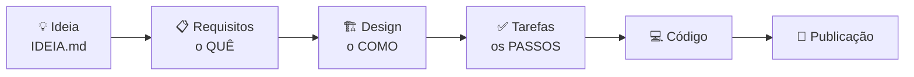

# 🐛☕ Oficina: da ideia ao GitHub com IA — Desenvolvimento Guiado por Especificação (SDD)

> Em **1 hora** você vai especificar, construir e publicar um jogo de navegador usando o **GitHub Copilot** dentro do **GitHub Codespaces**. É tudo gratuito, roda no navegador e não precisa instalar nada.

O objetivo não é o jogo, é o **processo**. Em vez de pedir "faz um jogo aí" para a IA (*vibe coding*), você vai conduzir a IA por etapas, escrevendo e revisando especificações **antes** de qualquer linha de código. Isso é o **SDD (Spec-Driven Development)**.

**Ao final você terá:**

- um repositório **seu** no GitHub, com as specs e o código;
- um histórico de commits que conta a história de cada fase;
- o jogo publicado em `https://SEU-USUARIO.github.io/SEU-REPOSITORIO/`, para mostrar para quem quiser.

---

## ✅ Antes da oficina (5 min, faça em casa)

- [ ] Ter uma conta no [GitHub](https://github.com/signup).
- [ ] Ativar o Copilot em <https://github.com/settings/copilot> (plano **Copilot Free**).
  - 🎓 **É estudante?** Solicite o [GitHub Education](https://education.github.com/pack): ele libera o plano **Copilot Student**, com mais cota que o Free. A verificação pode levar alguns dias, então peça com antecedência.
- [ ] Usar Chrome, Edge ou Firefox atualizado.
- [ ] *(Opcional, para ganhar tempo)* Já fazer o [Passo 0](#passo-0).

## 🗺️ Mapa da oficina

| Tempo | Etapa | Você sai com |
|---|---|---|
| 0:00 | Abertura: o que é SDD | — |
| 0:05 | [Passo 0 — Repositório e Codespace](#passo-0) | Ambiente pronto |
| 0:12 | [Passo 1 — A ideia](#passo-1) | `IDEIA.md` lida (e personalizada, se quiser) |
| 0:14 | [Passo 2 — Requisitos: o QUÊ](#passo-2) | `specs/requirements.md` |
| 0:24 | [Passo 3 — Design: o COMO](#passo-3) | `specs/design.md` |
| 0:31 | [Passo 4 — Tarefas: os PASSOS](#passo-4) | `specs/tasks.md` |
| 0:36 | [Passo 5 — Implementação](#passo-5) | Jogo funcionando |
| 0:51 | [Passo 6 — Publicação](#passo-6) | Link no GitHub Pages |
| 0:57 | Encerramento | — |

---

## 🧠 SDD em 2 minutos

Quando você pede tudo de uma vez para a IA, ela precisa **adivinhar** o que você quer. Às vezes acerta, mas muitas vezes você recebe 300 linhas de código que fazem *quase* o que você queria, e fica difícil saber o quê.

No SDD você quebra o trabalho em etapas, e cada etapa gera um documento curto que **você revisa e aprova** antes de seguir:



Entre uma etapa e outra existe um **portão**: você lê, ajusta e faz commit. **A IA escreve; você decide.**

| Arquivo | Responde a pergunta | Gerado por |
|---|---|---|
| `specs/requirements.md` | **O que** o sistema deve fazer? (histórias de usuário + critérios de aceitação) | `/1-requisitos` |
| `specs/design.md` | **Como** vamos construir? (arquitetura, arquivos, constantes) | `/2-design` |
| `specs/tasks.md` | **Em que ordem**? (passos pequenos e testáveis) | `/3-tarefas` |
| `.github/copilot-instructions.md` | Quais regras valem **sempre**? (stack, padrões, estrutura) | já vem pronto |

### Critérios de aceitação no formato EARS

Os requisitos usam o padrão **EARS** (*Easy Approach to Requirements Syntax*). São frases com estrutura fixa, fáceis de testar:

| Padrão | Exemplo |
|---|---|
| `O SISTEMA DEVE ...` | O SISTEMA DEVE exibir a pontuação no canto superior esquerdo. |
| `QUANDO <evento>, O SISTEMA DEVE ...` | QUANDO o dev encostar em um bug, O SISTEMA DEVE remover 1 vida. |
| `ENQUANTO <estado>, O SISTEMA DEVE ...` | ENQUANTO o jogo estiver na tela inicial, O SISTEMA DEVE ignorar as setas. |
| `SE <problema>, ENTÃO O SISTEMA DEVE ...` | SE as vidas chegarem a 0, ENTÃO O SISTEMA DEVE mostrar a tela de fim de jogo. |

### Por que isso acelera (de verdade) o desenvolvimento?

1. **A IA erra menos** quando o contexto é claro e está escrito em arquivos que ela lê.
2. **Você revisa menos e mais cedo**: corrigir uma frase no requisito é muito mais barato que caçar o erro em 300 linhas de código.
3. **As specs viram memória do projeto**: dá para parar e voltar outro dia, trocar de ferramenta de IA ou passar o projeto para outra pessoa.

---

<a id="passo-0"></a>

## Passo 0 — Crie seu repositório e abra o Codespace (7 min)

1. No topo desta página, clique em **Use this template → Create a new repository**.
2. Preencha:
   - **Owner:** a sua conta;
   - **Repository name:** `chuva-de-bugs` (ou o nome que preferir);
   - Visibilidade **Public**, que é necessária para publicar de graça no GitHub Pages.

   Depois clique em **Create repository**.
3. No **seu** repositório novo, clique em **Code → Codespaces → Create codespace on main**. Na primeira vez leva de 1 a 2 minutos.
4. Quando o editor abrir, abra o **Chat do Copilot** pelo ícone do Copilot no topo da janela ou com `Ctrl+Alt+I`. Se ele pedir login, entre com a sua conta do GitHub.
5. No seletor abaixo da caixa de texto do chat, escolha o modo **Agent**.

**Conheça o que veio no repositório:**

| Caminho | Para que serve |
|---|---|
| `IDEIA.md` | A ideia do projeto, o ponto de partida |
| `specs/` | Onde vão nascer os 3 arquivos de especificação |
| `.github/copilot-instructions.md` | Regras que o Copilot segue em **toda** conversa (stack, estrutura, estilo) |
| `.github/instructions/specs.instructions.md` | Regras que valem **só** ao escrever arquivos em `specs/` |
| `.github/prompts/*.prompt.md` | Os comandos de cada fase (`/1-requisitos`, `/2-design`...). Abra um e veja: é só um prompt bem escrito! |
| `.devcontainer/` | A configuração deste ambiente do Codespaces |

> 🔎 **Teste rápido (opcional):** pergunte no chat *"Quais instruções deste projeto você está seguindo?"*. Na resposta, procure a referência a `copilot-instructions.md`: é a prova de que o contexto permanente está funcionando.

---

<a id="passo-1"></a>

## Passo 1 — A ideia (2 min)

Abra `IDEIA.md`. Ela descreve o **Chuva de Bugs**: um dev 🧑‍💻 que coleta cafés ☕ e desvia de bugs 🐛 que caem do céu.

🎨 **Quer personalizar?** Troque o tema agora, **antes** de gerar os requisitos (por exemplo 🍕/🥦 ou ⭐/☄️). Mantenha a mecânica simples: o tempo é curto!

---

<a id="passo-2"></a>

## Passo 2 — Requisitos: o QUÊ (10 min)

1. No chat, digite `/1-requisitos` e pressione **Enter**.
2. O Copilot cria `specs/requirements.md`. Clique em **Keep** para aceitar o arquivo.
3. Abra o arquivo e veja o preview com `Ctrl+Shift+V`. **Revise** com estas perguntas:
   - Dá para **testar jogando** cada critério? "Rápido" não dá; "a cada 10 s a velocidade aumenta" dá.
   - Tem algo que você **não** quer? Está faltando alguma coisa?
   - Você concorda com o que está em **Suposições**?
4. **Refine** pelo chat com 1 ou 2 pedidos em linguagem natural. Sugestões:

   ```text
   Adicione controle por toque: tocar na metade esquerda ou direita da tela move o dev para aquele lado.
   ```

   ```text
   Adicione um item raro 💎 que vale 5 pontos e aparece pouco.
   ```

   ```text
   Analise os requisitos e aponte ambiguidades, contradições ou lacunas. Não altere o arquivo, só liste.
   ```

5. Quando estiver satisfeito, faça o **commit**. Abra um terminal com ``Ctrl+` `` e rode:

   ```bash
   git add -A && git commit -m "docs: requisitos" && git push
   ```

> 💡 **Por que commitar a cada fase?** Cada commit vira um ponto de restauração. Se a IA estragar algo na próxima etapa, você volta para cá.

---

<a id="passo-3"></a>

## Passo 3 — Design: o COMO (7 min)

1. No chat: `/2-design` e depois **Keep**.
2. Abra `specs/design.md` no preview (`Ctrl+Shift+V`). Os diagramas aparecem desenhados.
3. **Revise:**
   - Os arquivos e componentes fazem sentido para você?
   - A tabela do `CONFIG` concentra todos os números (velocidades, tamanhos, tempos)?
   - Cada componente diz quais critérios atende (`Atende: 1.1, 2.3`)?
4. **Peça conselho e refine**, como faria com um colega sênior:

   ```text
   Quero conseguir ajustar a dificuldade do jogo facilmente depois. O design atual permite isso? O que você sugere?
   ```

   Gostou da sugestão? Peça: `Atualize o design com essa sugestão.`
5. Commit:

   ```bash
   git add -A && git commit -m "docs: design" && git push
   ```

---

<a id="passo-4"></a>

## Passo 4 — Tarefas: os PASSOS (5 min)

1. No chat: `/3-tarefas` e depois **Keep**.
2. **Revise** `specs/tasks.md`:
   - Cada tarefa tem um **"Como verificar"** que você consegue fazer no navegador?
   - A ordem faz sentido? A tarefa 1 deixa algo visível na tela?
   - Cada tarefa aponta os requisitos que atende (`_Requisitos: 1.1, 1.2_`)? Isso se chama **rastreabilidade**.
3. Commit:

   ```bash
   git add -A && git commit -m "docs: plano de tarefas" && git push
   ```

---

<a id="passo-5"></a>

## Passo 5 — Implementação (15 min)

1. **Ligue o servidor.** No terminal, rode:

   ```bash
   npx --yes http-server -c-1 -p 8080
   ```

   Uma aba do navegador vai abrir com o seu jogo, que por enquanto está vazio. Se a aba não abrir, vá na aba **Ports** do painel inferior, encontre a porta **8080** e clique no ícone 🌐.
   Deixe esse terminal rodando e use um **novo terminal** (botão **+**) para os comandos do git.
2. No chat: `/4-implementar 1`
3. O Copilot cria e edita os arquivos. Se ele pedir para rodar algum comando, leia o comando antes de clicar em **Allow**. Depois, revise as mudanças e clique em **Keep**.
4. **Teste** no navegador: recarregue com `Ctrl+Shift+R` e siga o "Como verificar" da tarefa. Lembre de clicar na página do jogo antes de usar o teclado.
5. **Commit** usando a mensagem que o Copilot sugeriu, por exemplo:

   ```bash
   git add -A && git commit -m "feat: esqueleto do jogo (tarefa 1)" && git push
   ```

6. Repita para as próximas: `/4-implementar 2`, `/4-implementar 3`...

> ⏱️ **Atrasado?** `/4-implementar 2-5` faz várias tarefas em sequência. Você perde os pontos de revisão do meio, mas ganha tempo.

**Encontrou um bug?** Use o fluxo de correção guiado por spec, em vez de só pedir "conserta aí":

```text
/corrigir-bug o dev atravessa a borda direita da tela
```

O Copilot descobre qual requisito o bug quebra (ou adiciona um, se a spec tinha uma lacuna), encontra a causa raiz, faz a menor correção possível e registra tudo em `tasks.md`.

**Tela branca ou jogo travado?** Aperte `F12`, abra a aba **Console**, copie a mensagem de erro em vermelho e cole no chat: `Corrija este erro: <mensagem>`.

---

<a id="passo-6"></a>

## Passo 6 — Publique no GitHub Pages (5 min)

1. Confira que está tudo enviado. `git status` deve dizer *nothing to commit*. Se não disser, faça mais um commit e `git push`.
2. No seu repositório no GitHub, vá em **Settings → Pages**. Em **Build and deployment**, escolha:
   - **Source:** Deploy from a branch;
   - **Branch:** `main`, pasta `/ (root)`.

   Depois clique em **Save**.
3. Espere cerca de 1 minuto e recarregue a página. Vai aparecer **"Your site is live at..."**. Abra o link no celular e mande para os amigos! 🎉
4. **Deixe o repositório com cara de portfólio.** Este README é o roteiro da oficina; troque-o pelo README do **seu** projeto:

   ```text
   Reescreva o README.md para apresentar o meu jogo: nome, como jogar (controles), o link https://SEU-USUARIO.github.io/SEU-REPOSITORIO/ e uma seção "Como foi feito" explicando o fluxo SDD, com links para os arquivos em specs/.
   ```

   Depois: `git add -A && git commit -m "docs: readme do projeto" && git push`

---

## ⭐ Bônus: evolua o jogo com SDD

Funcionalidade nova também começa pela spec. O comando `/nova-funcionalidade` atualiza requisitos, design e tarefas **sem escrever código**. Depois você implementa com `/4-implementar`.

```text
/nova-funcionalidade escudo 🛡️ que cai de vez em quando e deixa o dev imune a bugs por 5 segundos
```

```text
/nova-funcionalidade combo: pegar 5 cafés seguidos sem perder vida dobra os pontos do próximo café
```

---

## 🎯 O que você praticou

- Separar **o quê** (requisitos), **o como** (design) e **os passos** (tarefas).
- Revisar texto curto **antes** de revisar código.
- Dar **contexto permanente** para a IA com arquivos de instruções.
- Trabalhar em **incrementos verificáveis**, com um commit por passo.
- **Rastreabilidade:** cada linha de código existe por causa de um requisito.

## 🔭 Indo além

O fluxo que você usou não é exclusivo do Copilot. A mesma ideia aparece em outras ferramentas:

| Conceito | Nesta oficina | Em outras ferramentas |
|---|---|---|
| Fases da spec | `/1-requisitos`, `/2-design`, `/3-tarefas` | Modo *Spec* do [Kiro](https://kiro.dev); comandos do [Spec Kit](https://github.com/github/spec-kit) |
| Contexto permanente | `.github/copilot-instructions.md` | *Steering files* (Kiro), `AGENTS.md`, `CLAUDE.md` |
| Regras por tipo de arquivo | `.github/instructions/*.instructions.md` (`applyTo`) | *Steering* com `fileMatch` (Kiro) |
| Executar o plano | `/4-implementar N` | *Start task* (Kiro), `/speckit.implement` |

Próximos passos sugeridos:

- **[Spec Kit](https://github.com/github/spec-kit):** o toolkit open source do GitHub para SDD, mais completo que esta oficina e compatível com vários agentes.
- **[Personalização do Copilot no VS Code](https://code.visualstudio.com/docs/copilot/customization/overview):** prompt files, instruções e agentes customizados.

---

## 🆘 Problemas comuns

| Sintoma | O que fazer |
|---|---|
| Os comandos `/1-requisitos` etc. não aparecem | Use o chat do **painel lateral** (não o chat inline) e confirme que o modo é **Agent**. Se continuar, rode `Ctrl+Shift+P` → **Developer: Reload Window**. |
| O Copilot pede login ou não responde | Confira se ele está ativo em <https://github.com/settings/copilot>. |
| Aviso de limite ou cota atingida | A cota do plano gratuito acabou. Continue em dupla com um colega e, se for estudante, peça o GitHub Education para as próximas vezes. |
| O jogo não reage ao teclado | Clique na página do jogo antes, para ela receber o foco. |
| A mudança não aparece no jogo | Recarregue com `Ctrl+Shift+R` e confira se você clicou em **Keep**. |
| Tela branca | `F12` → **Console** → copie o erro e cole no chat. |
| O GitHub Pages mostra 404 | Aguarde 1 ou 2 minutos. Confira se o `index.html` está na raiz e se o repositório é **público**. |
| `git push` rejeitado | Rode `git pull --rebase && git push`. |
| O Codespace "sumiu" | Ele hiberna depois de 30 min parado. Reabra em **Code → Codespaces**. |

## 🧹 Depois da oficina

Seu código já está no GitHub, então **apague o Codespace** para não gastar sua cota gratuita: acesse <https://github.com/codespaces>, clique em **⋯** ao lado dele e depois em **Delete**.

---

<sub>Facilitando esta oficina? Veja o [guia do facilitador](docs/facilitador.md).</sub>
