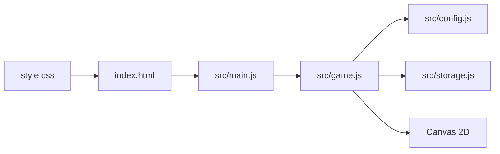
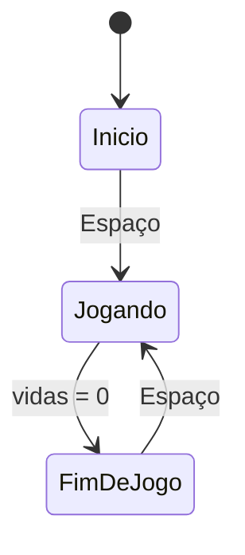

# Design — Chuva de Bugs

## Visão geral
O jogo será uma página HTML com um canvas centralizado, estilizado para lembrar um editor de código. O canvas desenha o dev e os itens usando formas simples e emojis, sem imagens ou áudio externos. Um único módulo de jogo controla o estado da partida, entrada do teclado, atualização dos itens, colisões e renderização. O recorde será lido e salvo no armazenamento do navegador.

## Decisões técnicas
| Decisão | Escolha | Por quê |
|---|---|---|
| Interface visual | Canvas 2D | Atende ao escopo visual e mantém o desenho em um único contexto. |
| Organização do código | JavaScript puro com ES modules | É a stack fixa do projeto e funciona no GitHub Pages sem build. |
| Loop do jogo | `requestAnimationFrame` com delta time em segundos | Mantém o movimento consistente entre diferentes taxas de atualização. |
| Entrada | Eventos `keydown` no documento | Permite usar setas e A/D e filtrar comandos pelo estado da partida. |
| Persistência | `localStorage` | Guarda o recorde depois que a página é fechada, sem servidor ou login. |
| Caminhos | Referências relativas | Permite publicar o jogo em um subcaminho do GitHub Pages. |

## Arquitetura


## Estrutura de arquivos
```text
index.html          Página e canvas do jogo.
style.css           Fundo, centralização e dimensões visuais da página.
src/config.js       Objeto CONFIG com todos os valores ajustáveis.
src/main.js         Ponto de entrada e preparação do canvas.
src/game.js         Estado, controles, loop, itens, colisões e desenho.
src/storage.js      Leitura e gravação do recorde no navegador.
```

## Componentes
### `index.html` — Página do jogo
- **Responsabilidade:** fornecer o canvas, o título da página e carregar o módulo principal por caminho relativo.
- **Estado:** nenhum estado de jogo; o estado fica no módulo do jogo.
- **Funções principais:** nenhuma função própria.
- **Atende:** 1.1, 1.2, 1.3, 1.4.

### `style.css` — Apresentação da página
- **Responsabilidade:** centralizar a área do jogo, aplicar o fundo escuro e definir a aparência da página.
- **Estado:** nenhum.
- **Funções principais:** nenhuma função própria.
- **Atende:** 1.1.

### `src/config.js` — Configuração central
- **Responsabilidade:** exportar o único objeto `CONFIG` com dimensões, velocidades, tempos, probabilidades, cores e emojis.
- **Estado:** somente valores constantes de configuração.
- **Funções principais:** nenhuma função própria.
- **Atende:** 2.3, 3.1, 3.2, 3.3, 3.4, 4.1, 4.2.

### `src/main.js` — Inicialização
- **Responsabilidade:** localizar o canvas, criar o contexto 2D, criar o jogo e iniciar o loop.
- **Estado:** referência do canvas e do contexto.
- **Funções principais:** `startGame(canvas)`: cria o jogo e inicia sua atualização visual.
- **Atende:** 1.1, 1.2, 1.3, 1.4, 5.1, 5.2, 5.3, 5.4.

### `src/game.js` — Motor da partida
- **Responsabilidade:** controlar telas, entrada, estado da partida, surgimento e movimento dos itens, colisões, pontuação, vidas e desenho.
- **Estado:** tela atual, posição do dev, itens ativos, pontuação, vidas, recorde, tempo decorrido e teclas pressionadas.
- **Funções principais:** `createGame(canvas, context)`: cria o estado inicial; `update(deltaTime)`: atualiza uma partida; `render()`: desenha a tela atual; `handleKeyDown(event)`: processa Espaço, setas e A/D; `resetGame()`: inicia uma partida com 3 vidas.
- **Atende:** 1.1, 1.2, 1.3, 1.4, 2.1, 2.2, 2.3, 2.4, 3.1, 3.2, 3.3, 3.4, 4.1, 4.2, 5.1, 5.2, 5.3, 5.4, 6.1, 6.3.

### `src/storage.js` — Recorde persistente
- **Responsabilidade:** encapsular o acesso ao recorde salvo no navegador.
- **Estado:** valor persistido sob uma chave fixa de configuração.
- **Funções principais:** `loadHighScore()`: retorna o recorde salvo ou 0; `saveHighScore(score)`: salva um novo recorde.
- **Atende:** 5.4, 6.1, 6.2, 6.3.

## Configuração central (`CONFIG` em `src/config.js`)
| Constante | Valor inicial | Para que serve | Atende |
|---|---:|---|---|
| `canvas.width` | 480 | Largura fixa da área do jogo | 2.3, 3.1 |
| `canvas.height` | 640 | Altura fixa da área do jogo | 3.1, 3.4 |
| `player.width` | 48 | Largura de colisão e desenho do dev | 2.3, 3.2, 3.3 |
| `player.speed` | 300 | Velocidade horizontal do dev em px/s | 2.1, 2.2 |
| `game.initialLives` | 3 | Vidas no início de cada partida | 1.3, 3.3 |
| `items.size` | 32 | Tamanho de colisão e desenho dos itens | 3.2, 3.3, 3.4 |
| `items.initialFallSpeed` | 120 | Velocidade inicial de queda em px/s | 4.1 |
| `items.speedIncreasePerSecond` | 4 | Aumento da velocidade por segundo | 4.1 |
| `items.initialSpawnInterval` | 1.2 | Intervalo inicial entre surgimentos em s | 4.2 |
| `items.spawnIntervalDecreasePerSecond` | 0.01 | Redução gradual do intervalo | 4.2 |
| `items.minimumSpawnInterval` | 0.35 | Limite inferior do intervalo | 4.2 |
| `items.coffeeChance` | 0.65 | Chance de surgir um café | 3.1 |
| `storage.highScoreKey` | `chuva-de-bugs-recorde` | Chave do recorde no navegador | 6.1, 6.2, 6.3 |
| `visual.playerEmoji` | `🧑‍💻` | Emoji do dev | 1.1 |
| `visual.coffeeEmoji` | `☕` | Emoji do café | 3.1 |
| `visual.bugEmoji` | `🐛` | Emoji do bug | 3.1 |

## Fluxo


Em cada quadro do loop principal:
1. Calcular o delta time em segundos desde o quadro anterior.
2. Se a tela estiver jogando, ler as teclas ativas e limitar a posição horizontal do dev.
3. Atualizar o tempo, a velocidade, o intervalo de surgimento e a posição dos itens.
4. Verificar colisões e itens que chegaram ao chão; ajustar pontuação, vidas e recorde.
5. Se as vidas chegarem a zero, salvar o recorde quando necessário e mudar para a tela de fim de jogo.
6. Limpar o canvas e desenhar a tela atual, os itens, o dev e as informações disponíveis.

## Propriedades de corretude
- Para qualquer quadro, o jogador fica dentro dos limites horizontais do canvas. (Valida: 2.3)
- Para qualquer item que alcance o chão sem colisão, pontuação e vidas permanecem inalteradas. (Valida: 3.4)
- Para qualquer colisão com café, o item é removido e a pontuação aumenta exatamente 1. (Valida: 3.2)
- Para qualquer colisão com bug, o item é removido e as vidas diminuem exatamente 1. (Valida: 3.3)
- Para qualquer partida encerrada, a tela exibida é a de fim de jogo e mostra a pontuação e o recorde. (Valida: 1.3, 5.3, 5.4)
- Para qualquer novo recorde, o valor salvo não é menor que o recorde anterior. (Valida: 6.1, 6.2)

## Casos limite
- Se o jogador pressionar Espaço enquanto a partida estiver em andamento, o comando não muda a partida.
- Se várias teclas de movimento forem pressionadas juntas, os deslocamentos são combinados e a posição continua limitada ao canvas.
- Se um item surgir perto de uma borda, sua posição deve permanecer dentro da largura do canvas.
- Se a pontuação final for igual ao recorde, o recorde não precisa ser alterado.
- Se o armazenamento do navegador não tiver valor para o recorde, o jogo usa 0.